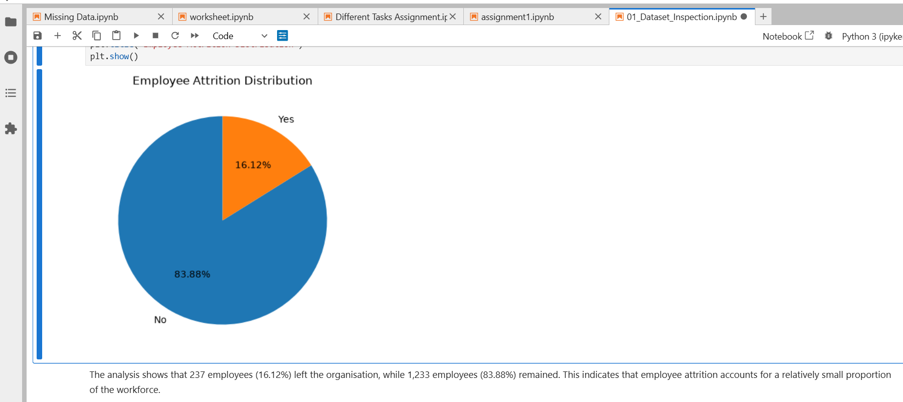
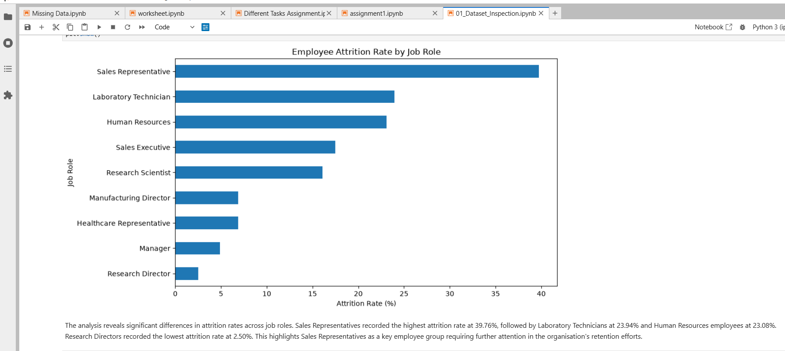
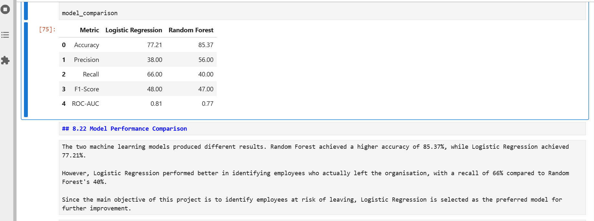
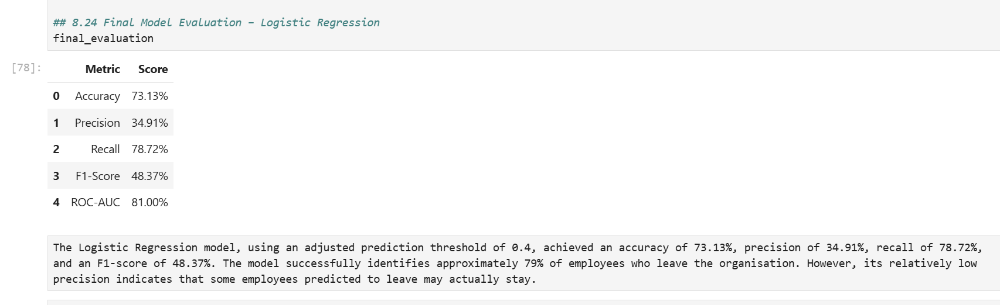

# HR Workforce Analytics: Employee Attrition Analysis and Prediction

## Project Overview

Employee attrition is an important challenge for organisations because high employee turnover can affect productivity, organisational performance and recruitment costs.

This project explores employee attrition patterns using the IBM HR Analytics Employee Attrition & Performance dataset. It applies data analysis and machine learning techniques to identify factors associated with employee turnover and develop a predictive model that can help organisations identify employees who may be at risk of leaving.

## Project Screenshots

### 1. Employee Attrition Distribution

### 2. Attrition by Job Role

### 3. Model Performance Comparison

### 4. Final Model Evaluation

## Project Objectives

- Explore employee data to understand workforce characteristics.
- Identify patterns and factors associated with employee attrition.
- Investigate relationships between employee satisfaction, overtime, job roles and attrition.
- Build machine learning models to predict employee attrition.
- Evaluate and compare model performance.
- Provide data-driven recommendations to support employee retention.

## Tools and Technologies

- Python
- Pandas
- NumPy
- Matplotlib
- Seaborn
- Scikit-learn
- Jupyter Notebook

## Project Workflow

The project followed these major stages:

1. Data Understanding
2. Data Cleaning and Quality Checks
3. Exploratory Data Analysis (EDA)
4. Feature Preparation
5. Train-Test Split
6. Model Building and Training
7. Model Evaluation
8. Model Interpretation and Recommendations

## Key Findings from the Exploratory Data Analysis

The analysis revealed several patterns associated with employee attrition:

- Overall employee attrition was approximately 16.12%.
- Sales had the highest departmental attrition rate at 20.63%.
- Single employees recorded a higher attrition rate (25.53%) than married and divorced employees.
- Employees with shorter tenure, particularly those with less than one year of service, recorded higher attrition.
- Sales Representatives had the highest attrition rate among the job roles examined, at 39.76%.
- Employees with lower job satisfaction and work-life balance recorded higher attrition rates.
- Overtime participation was associated with higher attrition.

Further investigation of Sales Representatives revealed associations between attrition, overtime participation, job satisfaction and monthly income.

## Machine Learning Models

Two classification algorithms were developed and evaluated:

1. Logistic Regression
2. Random Forest Classifier

Logistic Regression was selected as the preferred model because it demonstrated a stronger ability to identify employees who actually left the organisation.

The prediction threshold was adjusted from 0.5 to 0.4 to improve the model's ability to identify potential leavers.

## Final Model Performance

The selected Logistic Regression model achieved the following results:

| Evaluation Metric | Result |
|---|---:|
| Accuracy | 73.13% |
| Precision | 34.91% |
| Recall | 78.72% |
| F1-Score | 48.37% |
| ROC-AUC | 0.81 |

The model identified approximately 79% of actual employees who left the organisation. However, its relatively low precision indicates that some employees predicted to leave may actually stay.

## Recommendations

Based on the findings, the following recommendations were proposed:

- Strengthen employee onboarding and mentorship programmes, particularly for new employees.
- Review overtime practices and promote a healthier work-life balance.
- Improve employee satisfaction through regular feedback and engagement.
- Develop targeted retention strategies for high-attrition job roles, particularly Sales Representatives.
- Review compensation and employee benefits, especially in roles with higher attrition.

## Conclusion

This project demonstrates how exploratory data analysis and machine learning can be applied to workforce data to understand employee attrition patterns and predict potential employee turnover.

The findings provide useful insights that can support organisational decision-making and help develop more effective employee retention strategies.

## Dataset

IBM HR Analytics Employee Attrition & Performance dataset.

## Project Type

Data Analytics | Exploratory Data Analysis | Machine Learning | Classification
